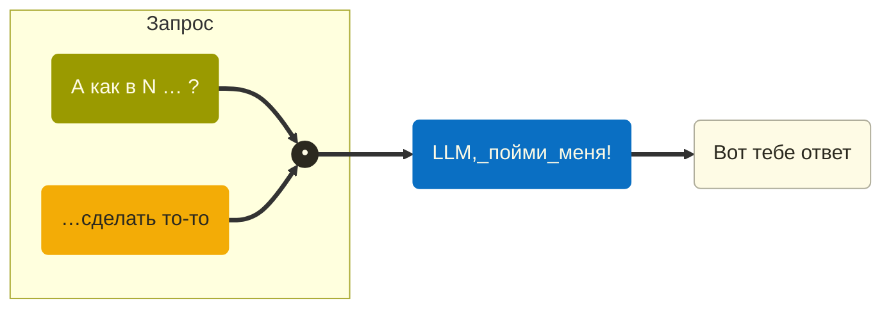

Youtube-запись от `2026-10-23`: https://youtu.be/n6ciDzA4B6I

# Локальный LLM `man` на примере `tmux`
Легко сделать контекстный **онлайн-** вызов запроса к LLM по горячей клавише. Но если вы живёте в стране с непредсказуемым прошлым, то — нет, не так уж и легко.

**Ситуация:** работаете в сложном инструменте, который нужно постоянно донастраивать.
Большинство ваших вопросов к мирозданию — «А как в N сделать то-то?».
**Обычно:** идём в окно с гуглилкой, объясняем чего хотим, получаем ответ, возвращаемся.
Но это доооооолго.
**Решение:** повесить форму _уточнения_ запроса на горячую клавишу + оборачивать уточнение в форму «А как в N … ?».



> [!tip]
> Контекст как бы сам ненавязчиво вырастает

Пользоваться хотим `llama`. Такое настроение.

Проблема в том, что на компьютере вовсю живёт Ollama. С подходящими моделями. Как бы нам их использовать?

Сначала сервер запустим:
```
ollama serve
```

Потом глянем на список моделей:
```bash
ollama list
```

А файлы где? А вот:
```
ollama show --modelfile qwen3.5:9b
```

Можно брать. Прямо вот с такими дикими названиями, да.

> [!important]
> Не забываем остановить сервер. \
> Куда нам два.

Давайте запустим `llama`:
```bash
llama-server \
  -m "$HOME/.ollama/models/blobs/sha256-02d45dc1cf451ba2475ac33b301c2dd8f985abe4c182ce04a1f2f5bf0260278d" \
  --alias llman \
  -c 65536 \
  -np 1 \
  -ngl all \
  -fa auto \
  --reasoning off \
  -n 512 \
  --perf
```

> [!caution]
> Что значат все эти ключи и откуда они на нас свалились?

Ладно, это сервер. А клиент?
Начнём с модного-красивого [aichat](https://github.com/sigoden/aichat).

Причём сразу с конфигурационного файла, чего уж там:
```yaml
model: llman:llman
stream: true
save_session: true
wrap: auto

clients:
- type: openai-compatible
  name: llman
  api_base: http://127.0.0.1:8080/v1
  models:
  - name: llman
```

> [!warning]
> Сессия сохраняется! Подарочек. \
> Может, она и дальше нам пригодится?

…но не всё так просто.

Спросим, как нам создать всплывающее окно, и сразу нарвёмся.

Будем страдать, пока не намекнём ну очень в лоб:
```aichat
.file "/Users/op/Library/Application Support/aichat/docs/tmux/display-popup.txt" -- Объясни по этой документации, как открыть плавающее окно с командой aichat.
```

Колхоз какой-то. Зато ответ есть:
```tmux
display-popup -E -w 80% -h 80% -T "llman" -s "transparent" 'aichat --session tmux'
```

Как не указывать файл каждый раз? Да мы ведь и не знаем, какой.

Бонус: можем спросить про привязку к горячей клавише. И снова нарвёмся. Нехорошо это.

Что ж, сделаем в лоб: закинем в роль прям весь `man tmux`.
И перезапустим сервер — это явно не 4 тыщи символов.
Новый ключ: `-c 65536`

…в общем, очень долго. Так дело не пойдёт.

Ответ — RAG. Ещё одно старое-новое слово про конструкцию LLM-систем. Не сегодня.

> [!tip]
> Так потихонечку всю экосистему LLM и изучим

А может, ответ — JEV? А может, ещё что-то? Оптимизируем будем, когда внедрим. Не раньше!

Да, а клавиша-то? В `.tmux.conf` дописываем:
```conf
unbind .
bind . display-popup -E -w 80% -h 80% -T "llman" -s "transparent" 'aichat --session tmux'
```
