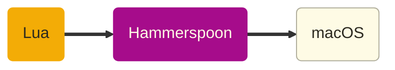

Youtube-запись от `2026-11-13`: https://youtu.be/qtgdSVnD4YQ
# Лабораторная по Hammerspoon и Lua

**Что это?** Прослойка между операционной системой и языком Lua.
**Короче**, можно писать и запускать Lua-скрипты — и так управлять macOS.



**Что угодно можно делать в системе?** Нет, только то, что реализовано в Hammerspoon API.


**Как устроен [код](https://github.com/Hammerspoon/hammerspoon)?** 
- Object C — основной язык разработки
- Lua — язык скриптов, которые и выполняются в среде Hammerspoon
- Модули на Lua обеспечивают Lua-скриптам интерфейс к macOS API
- Но реализация этих модулей — конечно, в коде на Object C

> [!tip]
> Задача Lua — работать встраиваемым языком в разные системы. \
> Обычно система создаёт — на самом Lua! — набор модулей, реализующих модель системы. \
> Так и выходит, что с помощью Lua моделью системы можно управлять. А значит, систему автоматизировать.

Интересно разобраться, как устроена реализация модулей.
Но это тогда будет не live coding, а кусок теории. Не будем.

### Поиграем

Терминал — точнее, консоль — тут свой. Давайте его очистим:
```lua
hs.console.clearConsole()
```

А вот и первый объект — [hs.console](https://www.hammerspoon.org/docs/hs.console.html).

> [!caution]
> Но в Lua нет объектов! \
> Нет. Но сделать можно. Вот и делают.

Ладно, пойдём читать [документацию](https://www.hammerspoon.org/docs/index.html).

Натыкаемся на первую же константу:
```lua
hs.console.defaultToolbar
```

И как это понимать?

Сходим в [hs.webview.toolbar](https://www.hammerspoon.org/docs/hs.webview.toolbar.html) и поймём хотя бы что-нибудь. Сразу видно, что всё крутится вокруг items:
```lua
hs.console.defaultToolbar:items()
```

Ну, сильно легче не стало. Но тип уже другой — таблица (она же массив). \
По таблицам можно ходить стандартным Lua-циклом:
```lua
for k, v in pairs(hs.console.defaultToolbar:items()) do print(k .. " → " .. v) end
```

### Отступление про книжки


> [!important]
> …если честно, про одну книжку

## [Программирование на языке Lua](https://olgpv.me/to/codelua), Роберту Иерузалимски, 2025 год, издательство «ДМК Пресс»

- Не очень сложно скупить все современные книжки, в которых хоть что-то написано про `C`  
- Но вот M5StickS3 у меня есть, а в нём как раз Lua
- Про Hammerspoon вы уже интуитивно догадываетесь
- Плагины для Neovim тоже на нём
- OBS готов ко встрече с Lua (там, правда, я не готова)
- Как насчёт Wireshark? Redis?
- Не играю, но трудно не заметить Factorio и Roblox
- Ну и куда деваться?

> [!tip]
> https://olgpv.me/to/codelua

Кажется, мы знаем эти пункты!

Глянем повнимательней хотя бы на один:
```lua
hs.console.defaultToolbar:itemDetails("prefs")
```

Шо, опять цикл?! Давайте упростим себе жизнь с помощью [hs.inspect](https://www.hammerspoon.org/docs/hs.inspect.html):
```lua
hs.inspect(hs.console.defaultToolbar:itemDetails("prefs"))
```

А как поменять надпись на кнопке?

```lua
hs.console.defaultToolbar:modifyItem({id = "prefs", label = "Свойства"})
```

Может, ещё чего поменяем? **Да!**
```lua
hs.console.darkMode(true)
hs.inspect(hs.console.consoleCommandColor())
hs.console.consoleCommandColor({blue=1, green=1, red = 1})
```

И давайте с [hs.console.consoleFont](https://www.hammerspoon.org/docs/hs.console.html#consoleFont) то же самое сделаем.

### Мы готовы идти по всей документации?

Весело, но долго. Но можно.

### Давайте, может, положим код в файл?

Давайте! Наконец-то VSCode, ура, дождались :)

#### Просто скриптом, и запустим из консоли
1. Скрипт кладём туда же, где и основной `init.lua`
2. Но разрешение ставим `.luascript` — чтобы не мешать основным скриптам.
3. Потом загружаем:
```lua
demoHotkey = dofile(hs.configdir .. "/standalone.luascript")
```
4. Содержимое скрипта == тело запускаемой функции.
5. Присваиваем переменной, чтобы не утащил сборщик мусора.

Кстати, и про [hs.hotkey](https://www.hammerspoon.org/docs/hs.hotkey.html) можно глянуть в документацию.
#### Пусть само работает

Переносим строку запуска в `init.lua` — и всё.
#### …но и другие тоже пусть работают
Для этого понадобится сделать [Spoon](https://github.com/Hammerspoon/hammerspoon/blob/master/SPOONS.md). То есть плагин. Есть [правила](https://github.com/Hammerspoon/hammerspoon/blob/master/SPOONS.md) и традиции.
1. Отдельная папка.
2. В ней — `init.lua`
3. Всё, что в этом файле, будет выполнено как тело функции.
4. Проще всего смотреть как на описание класса.
5. Нужны `:start()` и `:stop()`
6. Нужны метаданные — хотя бы `.name`.
7. Возврат `obj` традиционен для функций, работающих с «объектами».

Примерно так:
```lua
local obj = { name = "" }

function obj:start()
-- основная часть
    return self
end

function obj:stop()
-- основная часть
    return self
end

return obj
```

Остаётся подключить в основной `init.lua`:
```lua
-- Стилизация консоли Hammerspoon
hs.loadSpoon("MyStyle"):start()
```
### В чём, однако, основной бонус?
Можно следить за событиями.
И что-то делать, как только они случатся.

- нажатие клавиш и поведение мыши
- изменения каталогов и файлов
- сетевые подключения
- изменения экранов
- взаимодействия с окном
- подключения USB-устройств
- изменения в UI
- состояние батареи
- подключение аудиоустройств (можно Bluetooth)
- географическое местоположение (если включено)
- …

Слова, которые нам нужны: `watcher` • `subscribe` • `bind` • `observer` • `callback`
Причём `watcher` есть прямо в названиях файлов исходников.


###### Ссылки
- [Официальный сайт проекта Hammerspoon](https://www.hammerspoon.org)
- [GitHub-репозиторий команды Hammerspoon](https://github.com/Hammerspoon)
