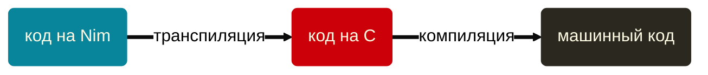
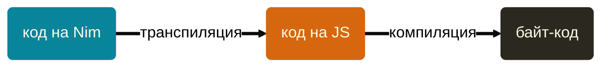
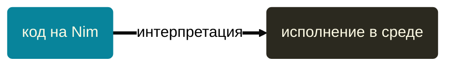

Youtube-запись от `2026-10-30`: https://youtu.be/13_Z1pXwS4w

> [!tip]
> Не только TypeScript хочет паразитировать на чужой инфраструктуре!

# Nim — ещё один язычок программирования
> [!important]
> Long story short: помесь Python и C.

> The language borrows heavily from (in order of impact):
> Modula 3, Delphi, Ada, C++, Python, Lisp, Oberon.
> *[Official FAQ](https://nim-lang.org/faq.html)*


## Языков слишком много, чтобы останавливаться

### Готовенькие, и много
`C` `TypeScript` `JavaScipt` `Python` `bash` `Lua`
- И это только полноценные языки!
- Топают ножкой `Go`, `Rust` и `Zig`
- Отчаялись дождаться своей очереди `C++` и `Java`
- А сколько их забыто…

### Пора сориентироваться в «языках вообще»
Лучший способ разобраться — заглянуть на кухню.


#### «[Создай свой собственный язык программирования](https://olgpv.me/to/createlang)», Клинтон Л. Джеффери, 2023, издательство «ДМК Пресс»

> *«Но даже в наше время нередко можно встретиться с платформой, где Java не запускается по умолчанию!»*

- высокий уровень абстракции;
- русский язык тяжеловат;
- начинаешь ориентироваться в инструментах;
- опасно близко подбираешься к теме IDE.

> [!tip] У теории появляется смысл
> Не то чтобы мы не знали про все эти токены и лексемы. Но они были скорей помехой на пути к написанию кода, да, да? А теперь можно поиграть с `flex`
> &nbsp;
> &nbsp;

**Disclaimer:** между мной и издательством ДМК действует соглашение о безвозмездном предоставлении доступа к книгам. Суть: беру почитать как в библиотеке и рассказываю, что хочу (или не рассказываю). Не реклама.
### Насладимся редким деликатесом — языком `Nim`

Посмотрим на тех, кто уже изрядно продвинулся на этом пути ~~изобретения велосипеда~~.

> [!warning] Основная идея: а давайте паразитировать на других языках!
> Точнее, на их мощнейшей инфраструктуре.
> «Пусть языки высокого уровня станут для нас языками не такого уж высокого уровня».

#### Компиляция через `C`


#### Компиляция через `JavaScript`



#### Исполнение через `NimVM`



Так мы получаем один язык для трёх сред: микроконтроллеры, системное программирование, браузерные приложения. Немного неожиданно.

Библиотеки — это уже про среду. А низкоуровневый код, конечно, выполняется на конкретной платформе.

Совсем коротко: «А давайте языки высокого уровня станут для нас языками не такого уж высокого уровня».


## Напишем, запустим, посмотрим
### Первый проход — Hello, World!
Текст программы и не отличишь от shell-скрипта:
```nim
echo "Hello, World!"
```

Откомпилируем:
```bash
nim c hello.nim
```

Посмотрим на промежуточные шаги компиляции:
```bash
nim c --nimcache:./nimcache hello.nim
```

Вместо файла можно задавать код прямо в командной строке:
```bash
nim e --eval:'let x = 17; echo x * x * x'
```

(ключ `e` можно опустить, а остальные ключи такие же — компиляция и т.п.)

### Настала очередь JavaScript

Получим JavaScript:
```bash
nim js hello.nim
```

Можно сразу и запускать:
```bash
node nimcache/cmdfile.js
```

А в браузере? А там свои объекты:
```nim
import std/dom

let heading = document.createElement("h1")
heading.textContent = "Hello from Nim!"
document.body.appendChild(heading)
```

Понадобится HTML-файлик для подключения JavaScript-файла:
```html
<!DOCTYPE html>
<html>
<body>
  <script src="hello.js"></script>
</body>
</html>
```

### Мелкие настройки
Вернёмся к компилятору. Что за подсказки?
```txt
Hint: used config file '/opt/homebrew/Cellar/nim/2.4.0/nim/config/nim.cfg' [Conf]
```

Хоть лишние сообщения уберём: `hints:off`

## Немного синтаксиса

### База
- **Переменные:** `var` — `const` — `let` • да хоть кириллицей • `_` в игнор • регистр первой буквы
- **Типизация:** статическая • угадывает
- **Числа:** операции ожидаемы • типы надо приводить руками
- **Символы и строки:** всё ожидаемо • спец. символы как в `C` • конкатенация — `,` при выводе или `&`
- **Операции сравнения:** булевые без сюрпризов • можно с равнивать строки с символами

### Управление потоком выполнения программы
`if` `elif` `else` — без сюрпризов

`case` — варианты через `of` • можно перечислять через запятую

`for` `in` — итерации, похожие на Python

Интересно:
```nim
for n in 3 ..< 7: 
  echo n
```

`countup()` `countdown()` — для произвольных шагов

Строку разбираем посимвольно:
```nim
let string = "abracadabra"

for l in string:
  echo l
```

Можно и с номерами:
```nim
for i, l in string:
  echo "Символ ", i, " → ", l
```

> [!warning]
С кириллицей номер не пройдёт.

А вот так – нормально:

```nim
import std/unicode

let s = "Привет"

for c in s.runes:
  echo c
```

Детали, как всегда, в документации: https://nim-lang.org/docs/unicode.html

`while` + `inc` — без чудес

`break` `continue` — как всегда

### Массивы
**Плохая новость:** длина *массива* вычисляется при компиляции, не во время исполнения.
```nim
const m = 3

var a: array[m, char] = "bla"
```

**Хорошая новость:** массивы переменной длины существуют — просто называются последовательностями.

```nim
var
  s: seq[int] = @[]   
  f = @["abc", "def"]  # сам угадывает, что это строки
  
s.add(8)
f.add("мяу")

echo s[^1]  # последний элемент
echo s.len  # длина последовательности

echo f[f.len - 1]  # тоже последний элемент
```

**Совсем хорошая новость:** массивы можно передавать как аргументы, эээ, функции.

Есть и срезы через `..`, как в цикле.
Срезу можно назначать значение.

Есть и кортежи:
```nim
var t = (страна: "Россия", площадь: 17_000_000, класс_энергоэффективности: 'E')
echo t[страна]
```

### Функции (точнее, процедуры)
Хотим менять значение (т.е. работаем как с указателем):
```nim
proc change_var(v: var int) = 
  inc v
```

Просто передаём значение, и никаких изменений:
```nim
proc fix_var(v: int) = 
  echo var
```

Внешние переменные видны себе спокойненько:
```nim
var ex = 0

proc inc_ex() = 
  inc ex
```

Можно вызывать через точку к первому аргументу:
```nim
proc deg(ex: var int, d: int) = 
  var mult = ex
  for i in 1 ..< d:
    ex *= mult

var e = 7
e.deg(5)
echo e 
```

`result` — имя переменной, значение которой возвращается по умолчанию

Можно отделять объявление от реализации, как в `C`

Модули — без чудес.

### Ввод-вывод
В модуле `strutils` уже лежит всё полезное:
```nim
import strutils

let content = readFile("my_file.txt")
let lines = content.splitLines()
echo lines
```

`strip()` избавит нас от строки-пустышки.

Чтение пользовательского ввода — ожидаемо, `readLine(stdin)`

`parseInt()` считывает число из строки

`map()` применяет процедуру (может и лямбду) ко всем элементам последовательности

`mapIt()` вычисляет *синтаксическое* выражение для каждого элемента последовательности

> [!caution]
> Естественно, тут легко запутаться. \
> Но если разобраться, то дело пойдёт. \
> Вдруг вы ещё не разобрались в других языках программирования. \
> Пора.

### Со звёздочкой
- Можно создавать итераторы
- Можно [создавать операторы](https://nim-by-example.github.io/procs/) (прямо смысл значков задавать, да)
- Объекты — вроде ничего необычного
- Есть смысл покопаться в возможностях типизации, там интересно
- Команды препроцессора (ну а как перевести `pragma`?) — целый мир
- Конечно же, есть форматирование вывода
- Многопоточность не так грустна, как в Python; есть и асинхронность
- Можно сравнить с другими языками — например, [с C](https://github.com/nim-lang/Nim/wiki/Nim-for-C-programmers), [c Python](https://github.com/nim-lang/Nim/wiki/Nim-for-Python-Programmers) и [с TypeScript](https://github.com/nim-lang/Nim/wiki/Nim-for-TypeScript-Programmers#table-of-contents).


## Куда копать
### [FrameOS](https://frameos.net)


 - Операционка (или просто среда) для создания цифровых рамок.
 - На Nim написана среда исполнения на железе (runtime).
 - А могли бы написать на Rust или Go, но — видимо, нагрузка? Нет ответа.
 - Сейчас там ещё и пользовательские скрипты на Nim, но это ненадолго — JavaScript побеждает.

### Динамичные источники информации
- [nim-lang.org](https://nim-lang.org) — официальный сайт языка
- [nim-lang/Nim](https://github.com/nim-lang/Nim) — GitHub-репозиторий языка, инструментов и документации
- [Nim Manual](https://nim-lang.org/docs/manual.html) — официальная же документация
- [r/nim](https://www.reddit.com/r/nim/) — Reddit-сообщество
- [Nim basics](https://narimiran.github.io/nim-basics/) — пособие для начинающих, хорошее
- [Nim by Example](https://nim-by-example.github.io) — набор рецептов для быстрого погружения в язык
- [Awesome Nim](https://github.com/ringabout/awesome-nim) — классический формат подборок на GitHub
- [Style Guide](https://nim-lang.org/docs/nep1.html) — часть официальной документации
- [Nim Tutorial](https://nim-lang.org/docs/tut1.html) — часть официальной документации

### Непристойная пропаганда обычных книг
- "[Mastering Nim](https://dokumen.pub/mastering-nim-2nbsped-9798858828624.html)", Andreas Rumpf, 2023 — написал создатель языка
- "[Nim in Action](https://www.amazon.nl/Nim-Action-Dominik-Picheta/dp/1617293431)", Dominik Picheta, 2017 — можно купить на Озоне ~~или «некупить» известно где~~
- "[Annotated Algorithms in Nim](https://github.com/mdipierro/nlib-nim)", Massimo Di Pierro, 2026 — на GitHub есть бесплатный авторский PDF; LLM-миграция исходного авторского Python-кода

