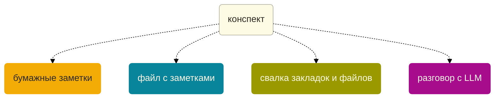

Youtube-запись от `2026-11-27`: https://youtu.be/WpdIcq5KRTQ

# Откроем SQL-базу, в которую нас не звали, и заберём свои данные
---


> [!caution]
> Халявы не будет. \
> Данные придётся добыть в честном бою.

### Сюда доходят все

Экосистема Apple славится своей закрытостью.
Но: эй, это же мои записи!
Поэтому надо копать.

`$HOME/Library/Group Containers/group.com.apple.VoiceMemos.shared/Recordings` — папка с аудиофайлами.

И, кажется, с чем-то ещё.

### А сюда — только самые упоротые

#### Узнаем, что за файл перед нами
```bash
file CloudRecordings.db
```
Это же база данных [SQLite](https://sqlite.org/). Ой. А что в ней?

#### Как устроена эта база?
Узнаем схему этой базы. Официальный термин, между прочим.

```sql
sqlite3 -readonly CloudRecordings.db ".schema"
```

Много-много `CREATE TABLE` и `CREATE INDEX`. Ограничимся пока что только таблицами.


> [!caution]
> Почему нас не интересуют файлы `*.db-wal` и `*.db-shm`? \
> Потому что они подхватятся автоматически, когда мы будем использовать утилиту `sqlite`.

#### Ура, у нас в руках инструмент!
Дальше все эксперименты можно проводить с помощью утилиты `sqlite3`.
Вот инструкция: https://sqlite.org/cli.html

Для исследования лучше и дальше работать в readonly-режиме:
```sql
sqlite3 -readonly CloudRecordings.db`
```

#### Исследуем поля

Какая из таблиц в базе самая полезная? Наверное, самая первая в схеме. То есть `ZCLOUDRECORDING`.

Выведем всё из этой таблицы:
```sqlite
SELECT * FROM ZCLOUDRECORDING;
```

Ну и каша.

Разумная задача — понять, какие полезные поля по записям есть в базе. Не все подряд, а именно полезные.
Но полей много, поэтому стандартные SQL-запросы возвращают не красивые таблицы, а адскую мешанину.
Таблица не получается — строка в строку не умещается.

Выход — использовать режим `.mode line`.
Он как раз и нужен для того, чтобы про каждую запись в таблице выводить данные в формате «Поле: значение».
Так гораздо легче сверять поля со значениями.

И сразу видно, какие поля самые интересные:
```sqlite
                Z_PK: 120
               Z_ENT: 1
               Z_OPT: 21
   ZAUDIOFUTUREFLAGS: 0
              ZFLAGS: 4
        ZSHAREDFLAGS: 3
ZSILENCEREMOVEREN...: 0
 ZSKIPSILENCEENABLED: 1
   ZSTUDIOMIXENABLED:
             ZFOLDER: 1
               ZDATE: 816615428.57885099
           ZDURATION: 4.3178333333333336
       ZEVICTIONDATE:
      ZLOCALDURATION: 4.3178333333333336
         ZMTLAYERMIX: 0.0
   ZPLAYBACKPOSITION: 0.0
       ZPLAYBACKRATE: 1.0
      ZPLAYBACKSPEED: 1.0
     ZSTUDIOMIXLEVEL:
        ZCUSTOMLABEL: 2026-11-17T13:37:08Z
ZCUSTOMLABELFORSO...: Новая запись 2
     ZENCRYPTEDTITLE: Новая запись 2
               ZPATH: 20261117 143708.m4a
           ZUNIQUEID: BE05CDEF-88E5-4EB2-8639-57FE83D3C801
   ZAUDIOFUTUREUUIDS: bplist00�^A^B^C^D^E^F^G
                      X$versionY$archiverT$topX$objects^R^@^A��_^P^ONSKeyedArchiver�^H
                      Troot�^A�^K^L^R^V^\U$null�^M^N^O^QZNS.objectsV$class�^P�^B�^D�^S^N^T^U\NS.uuidbytesO^P^P4�fS�K���
                      SC6��^P�^C�^W^X^Y^ZZ$classnameX$classesVNSUUID�^Y^[XNSObject�^W^X^]^^WNSArray�^]^[^H^Q^Z$)
                      27ILQSY_dovxz|�����������...
        ZAUDIODIGEST:
        ZAUDIOFUTURE: ^C###�R^A^@^@^@^@^@4�fS�K���SC6��^P34F18366-53D6-4B95-A3E2-5343369BBF10
      ZMTAUDIOFUTURE:
ZVERSIONEDAUDIOFU...:
```

#### Есть названия записей, а есть названия файлов
Сверим названия записей в базе с теми файлами, что у нас есть в файловой системе:
```sql
.mode box
SELECT
    ZENCRYPTEDTITLE, ZPATH
FROM ZCLOUDRECORDING;
```

В базе нашлись абсолютно все файлы, которые есть на диске.

> [!tip]
> Это даёт надежду на то, что мы сможем спосойно пользоваться данными из базы. \
> Как минимум в режиме чтения. А если повезёт, то и записи.

#### Посмотрим на таблицы
Какие, кстати, ещё данные есть в базе? Например, какие таблицы?

Это узнать легко: `.table`

Результат:
```text
ACHANGE                            ANSCKMIRROREDRELATIONSHIP                      ATRANSACTIONSTRING
ANSCKDATABASEMETADATA              ANSCKMIRROREDRELATIONSHIPSYSTEMFIELDSASSET     ZCLOUDRECORDING
ANSCKEVENT                         ANSCKRECORDMETADATA                            ZDATABASEPROPERTY
ANSCKEXPORTEDOBJECT                ANSCKRECORDMETADATAENCODEDRECORDASSET          ZENTITYREVISION
ANSCKEXPORTMETADATA                ANSCKRECORDMETADATASYSTEMFIELDSASSET           ZFOLDER
ANSCKEXPORTOPERATION               ANSCKRECORDZONEMETADATA                        ZMIGRATION
ANSCKHISTORYANALYZERSTATE          ANSCKRECORDZONEMETADATAENCODEDSHAREASSET       ZRECORDING
ANSCKIMPORTOPERATION               ANSCKRECORDZONEMOVERECEIPT                     Z_METADATA
ANSCKIMPORTPENDINGRELATIONSHIP     ANSCKRECORDZONEQUERY                           Z_MODELCACHE
ANSCKMETADATAENTRY                 ATRANSACTION                                   Z_PRIMARYKEY
```

Ясно, что служебных таблиц очень много. Логи там всякие, такое. Их смотреть не стоит. А какие стоит? Наверное, те, в которых хоть какие-то записи есть, но при этом их не очень много. А в каких таблицах сколько записей?

```bash
sqlite3 -readonly CloudRecordings.db "
SELECT group_concat(
  printf('SELECT %Q AS table_name, COUNT(*) AS row_count FROM \"%w\"', name, name),
  ' UNION ALL '
) || ';'
FROM sqlite_schema
WHERE type = 'table' AND name NOT LIKE 'sqlite_%';
" | sqlite3 -readonly -header -column CloudRecordings.db
```

Это мы что сейчас сделали?
Это мы создали запрос с помощью `printf` и данных из таблицы `sqlite_schema`.
И потом применили его к исследуемой базе.
Удобно, что таблицы описаны с помощью других таблиц.
SQL в роли препроцессора для самого себя.

Результат примерно такой:
```text
                table_name                  row_count
------------------------------------------  ---------
ZCLOUDRECORDING                                    15
ZDATABASEPROPERTY                                   0
ZENTITYREVISION                                     0
ZFOLDER                                             1
ZMIGRATION                                          1
ZRECORDING                                          0
Z_PRIMARYKEY                                       27
Z_METADATA                                          1
Z_MODELCACHE                                        1
ACHANGE                                           836
ATRANSACTION                                      715
ATRANSACTIONSTRING                                106
ANSCKDATABASEMETADATA                               1
ANSCKEVENT                                       1374
ANSCKMETADATAENTRY                                  7
ANSCKRECORDMETADATA                                17
ANSCKRECORDMETADATAENCODEDRECORDASSET              17
ANSCKRECORDZONEMETADATA                             1
ANSCKEXPORTEDOBJECT                                 0
ANSCKEXPORTMETADATA                                 0
ANSCKEXPORTOPERATION                                0
ANSCKHISTORYANALYZERSTATE                           0
ANSCKIMPORTOPERATION                                0
ANSCKIMPORTPENDINGRELATIONSHIP                      0
ANSCKMIRROREDRELATIONSHIP                           0
ANSCKMIRROREDRELATIONSHIPSYSTEMFIELDSASSET          0
ANSCKRECORDMETADATASYSTEMFIELDSASSET                0
ANSCKRECORDZONEMETADATAENCODEDSHAREASSET            0
ANSCKRECORDZONEMOVERECEIPT                          0
ANSCKRECORDZONEQUERY                                0
```


С помощью `grep -v 0` оставляем только непустые:
```text
ZCLOUDRECORDING                                    15
ZFOLDER                                             1
ZMIGRATION                                          1
Z_PRIMARYKEY                                       27
Z_METADATA                                          1
Z_MODELCACHE                                        1
ANSCKDATABASEMETADATA                               1
ANSCKMETADATAENTRY                                  7
ANSCKRECORDMETADATA                                17
ANSCKRECORDMETADATAENCODEDRECORDASSET              17
ANSCKRECORDZONEMETADATA                             1
```

Исследуем в `.mode line`, чтобы наглядней сравнивать поля с осмысленными данными.

`ZCLOUDRECORDING` — (уже знаем) основная информация о записях
`ZFOLDER` — папки, которые вручную создал пользователь (не смарт-папки «Все записи», «Избранное» и «Недавно удалённые»)
`ZMIGRATION` — (предположительно) дата переезда из старого формата Voice Memo в новый
`Z_PRIMARYKEY` — физический смысл и ещё кое-какие параметры поля `Z_ENT` в разных таблицах базы
`ANSCKRECORDMETADATA` — метаданные записи; явно заслуживают дополнительного исследования
`ANSCKRECORDMETADATAENCODEDRECORDASSET` — (предположительно) звук в бинарном формате, но лежит не в файле, а в базе данных

Ну и хватит пока что.

#### Приём 1 • Делаем даты удобными
По ходу исследования вы много где увидите даты. Хорошо бы их читать без проблем, чтобы, сверяя эти даты с событиями реального мира, догадываться и о смысле записей в таблице.

Проблема в том, что даты выглядят так:
```sql
ZDATE: 749072132.19332695
```

Это [число секунд с 1 января 2001 года](https://developer.apple.com/documentation/foundation/nsdate/datewithtimeintervalsincereferencedate%3A) (не спрашивайте).

Чтобы прочесть, приводим эти секунды к стандартной длительности в секундах по [времени UNIX](https://en.wikipedia.org/wiki/Unix_time), а потом переводим в человекочитаемый формат вашей [локали](https://en.wikipedia.org/wiki/Locale_(computer_software)):
```sql
SELECT
    datetime(ZDATE + 978307200, 'unixepoch', 'localtime') AS "дата"
FROM ZMIGRATION;
```

Можно и без кавычек вокруг псевдонима вычисленного поля. Но с ними как-то спокойней. Вдруг пробел.

#### Вообще-то мы исследуем диктофонные записи, а не SQLite
Вернёмся к записям. Что нам про них ещё хочется знать?
1. Удалены или нет? Нас интересуют только те, что не удалены.
2. Какая длительность? Слишком длинные мы не сможем обработать.
3. Можно ли понять, что запись лежит в такой-то папке? Возможно, мы захотим обрабатывать (или не обрабатывать) записи из конкретных папок.
4. Можно ли понять, что запись не лежит ни в одной папке? Возможно, мы захотим рассортировывать записи по папкам.
5. Когда сделана запись?
6. Где географически сделана запись?
7. На каком устройстве сделана запись?

#### Приём 1 • Ищем запись по названию
Проблема: Voice Memo не даёт нам никаких способов опознать запись, кроме как по имени. А значит, нам надо научиться искать записи по имени и внимательно их разглядывать. А то и сравнивать.

Например, давайте назовём удалённую запись — сюрприз! — «удалённая запись».
А не удалённую — вы не поверите — «не удалённая запись».
И попробуем найти в базе только те записи, в названии которых есть слово «удалённая».
```sql
SELECT *
FROM ZCLOUDRECORDING
WHERE ZENCRYPTEDTITLE LIKE '%удалённая%';
```

#### Приём 2 • Смотрим на связанные записи в разных таблицах
Давайте ещё кое-что заметим: записи о записях (ой) лежат в двух разных таблицах — `ZCLOUDRECORDING` и `ANSCKRECORDMETADATA`. И когда мы будем разглядывать данные о конкретной записи, то нам точно захочется получать данные про неё одним запросом, а не двумя. И так по всем записям. Как?

```sql
SELECT a.*, b.*
FROM ZCLOUDRECORDING AS a
JOIN ANSCKRECORDMETADATA AS b
    ON a.Z_PK = b.Z_PK;
```

Конечно, для уточнения запроса можно добавлять `WHERE`, как обычно.

```sql
SELECT a.*, b.*
FROM ZCLOUDRECORDING AS a
JOIN ANSCKRECORDMETADATA AS b
    ON a.Z_PK = b.Z_PK
WHERE a.ZENCRYPTEDTITLE LIKE '%удалённая%';
```

Ой! А куда же делась запись «не удалённая запись»? Очень интересно.
Дело, конечно же, в том, что `JOIN` оставляет нам только те записи из `a`, у которых нашлась эквивалентная запись из `b`. И, похоже, никаких уточнений в `ANSCKRECORDMETADATA` для записи «не удалённая запись» мы не обнаружили. Это само по себе интересно, но можно всё-таки выводить все записи со словом «удалённая»?

Легко. Замените `JOIN` на `LEFT JOIN` — и готово. Сработает `WHERE`, но после этого `JOIN` не отбросит записи без связок.

```sql
SELECT a.*, b.*
FROM ZCLOUDRECORDING AS a
LEFT JOIN ANSCKRECORDMETADATA AS b
    ON a.Z_PK = b.Z_PK
WHERE a.ZENCRYPTEDTITLE LIKE '%удалённая%';
```

#### Приём 3 • Полные названия полей

Возможно, вас уже раздражают обрезанные названия полей таблиц. Тогда выведите их один раз целиком для справки:
```sql
.mode list
SELECT name FROM pragma_table_info('ZCLOUDRECORDING');
```

Не забудьте потом переключиться в тот `.mode`, который вам сейчас комфортен: https://sqlite.org/climode.html#changing_output_formats

#### Приём 4 • Выводы из связки «название записи — значение поля»
А чтобы сравнивать значения одного и того же поля у разных записей, удобно делать так:
```sql
.mode table
SELECT ZENCRYPTEDTITLE, <исследуемое поле> FROM ZCLOUDRECORDING;
```

И получите аккуратную табличку: слева имя — справа значение исследуемого поля.
Некоторые выводы можно так сделать достаточно быстро. Особенно выводы о том, что поле для вас никакого интереса не представляет.

#### Ответы без решений, вдруг вам надо
Ну всё, достаточно подготовительных приёмчиков. Пришло время экспериментировать с названиями записей в таблице `ZCLOUDRECORDING` (и других таблицах на ваше усмотрение), разглядывать следы этих экспериментов в базе данных и делать выводы о том, что и где в этой базе хранится.

Ниже — только ответы на вопрос «Что значит конкретное поле в базе `ZCLOUDRECORDING`?».
А суть экспериментов в том, чтобы придумать, как эти ответы получить.

`Z_PK` — внутренний ID записи, удобен для поиска по базе, физического смысла нет, присваивается подряд
`Z_OPT` — почти все (но не все) значения отличаются; смысл непонятен
`ZAUDIOFUTUREFLAGS` — везде нули; вряд ли что-то ценное
`ZFLAGS` — равно 12, если переименовывали запись руками; для автоматических имён стоит 4
`ZSHAREDFLAGS` — для избранного точно стоит бинарный флаг 1, остальные выводы сомнительны: кажется, что для записи в папке — бинарный флаг 10 (~ 2); но для второй папки уже не сработало! флаги точно складываются: 1 + 10 = 11 (~ 3)
`ZSILENCEREMOVERENABLED` — (предположительно) для записи включён режим «Вырезать тишину»
`ZSKIPSILENCEENABLED` — (предположительно) для записи включён режим «Пропускать тишину»
`ZSTUDIOMIXENABLED` — всюду пусто; вряд ли что-то ценное
`ZFOLDER` — ID папки, в которой лежит запись; пусто, если нигде не лежит; ID папок — поле `Z_PK` в таблице `ZFOLDER`
`ZDATE` — дата записи (в секундах по времени Apple)
`ZDURATION` — длительность записи (в секундах)
`ZEVICTIONDATE` — момент удаления; поле заполнено только у удалённых записей (так и можно понять, что запись, собственно, удалена)
`ZLOCALDURATION` — и снова длительность записи (в секундах); чем отличается от `ZDURATION` — непонятно
`ZMTLAYERMIX` — где-то 0.0, но в основном пусто; странно, но вряд ли нужно
`ZPLAYBACKPOSITION` — с какого места включать воспроизведение
`ZPLAYBACKRATE` — с какой скоростью проигрывать
`ZPLAYBACKSPEED` — и снова с какой скоростью проигрывать (похоже, полный дубль для совместимости)
`ZSTUDIOMIXLEVEL` — всюду пусто; вряд ли что-то ценное
`ZCUSTOMLABEL` — внезапно снова дата записи, но уже в формате локали
`ZCUSTOMLABELFORSORTING` — название, по которому будут сортировать
`ZENCRYPTEDTITLE` — собственно название; никаких отличий от `ZCUSTOMLABELFORSORTING` не видно
`ZPATH` — имя файла записи; это имя и видно в папке `Records`
`ZUNIQUEID` — UUID; скорее всего, для облачных задач
`ZAUDIOFUTUREUUIDS` — что-то бинарное
`ZAUDIODIGEST` —  всюду пусто; вряд ли что-то ценное
`ZAUDIOFUTURE` — что-то бинарное; в начале какие-то UUID
`ZMTAUDIOFUTURE` —  всюду пусто; вряд ли что-то ценное
`ZVERSIONEDAUDIOFUTURE` —  всюду пусто; вряд ли что-то ценное

Таким образом, мы не нашли ответа на два вопроса: где географически и на каком устройстве сделана запись.
На остальные вопросы из списка выше ответы мы умеем находить.
Этого с избытком хватит для нашей задачи.

## Хочется большего


Курс «[Интерактивный тренажёр по SQL](https://stepik.org/course/63054/)» на Stepik (бесплатно).

Обратите внимание: даже в этом шикарном курсе примеры несколько, хм, искусственные.
А тут у вас живая база данных, которая как-то устроена и чем-то занята.
Совсем другие ощущения.


> [!caution]
> Почему не напустить LLM? \
> Можно и нужно. Пробуйте.
> **Но** `MCP` — дополнительный посредник. Всегда.
> https://mcpservers.org/ru/servers/panasenco/mcp-sqlite — где-то тут что-то есть.

## А поговорить в комментах?

Как вы ведёте конспект при исследовании нового технического вопроса?


