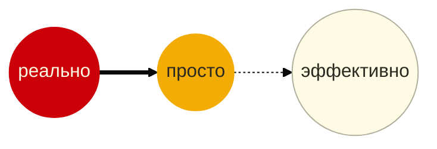

Youtube-запись от `2026-11-20`: https://youtu.be/eAcxARwg6bQ

# Как смотреть на плату с микроконтроллером
…и выдумывать, что с ней можно сделать

## Компьютер с пелёнок — это проблема
> [!warning]
> Check your privileges. \
> Мы так привыкли к результатам труда поколений инженеров, что считаем их само собой естественными правами.

1. **Не осознаём** удобства от USB, операционной системы, разработки и запуска на одном железе, целой лестницы уровней абстракции для защиты от проблем с питанием.
2. **Не чувствуем**, что используем память, что используем время как ресурс. 
3. **Не особенно экономим** электричество и в целом не выключаем компьютер. 
4. **Не догадываемся** про всю сложность радиосвязи и разнообразие сетевых архитектур. 
5. **Не сталкиваемся** с ситуацией «Непонятно, как даже физически подключить одно устройство к другому». 
6. **Не думаем** о параллельности обработки задач. 
7. **Не выбираем** между программным и аппаратным решением — или по умолчанию выбираем в сторону программного). 
8. **Не управляем** физическими объектами с компьютера, живём полностью в цифровом мире.
9. **Не ищем** причину ошибки глубже, чем ошибка в коде.
10. …

## И вот мы смотрим на недокомпьютер — и что видим?

##### Красивое

##### Непонятное

> [!tip]
> Срочно заберите мои деньги! \
> Хотя постойте-ка…

##### Конкретное
- Много-много памяти ~~детишкам принесла~~
- Можно запросто вшить в лямку рюкзака
- Кажется, имеет шанс подключиться к моему, хм, автомобилю
- Может помигать светодиодиком
- Точно подключится к десктопу через USB-C

##### Невидимое
- А что, беспроводного ничего не завезли?
- Кнопок под мои задачи тоже нет?
- Лично я смогу что-нибудь тут написать и запустить?
- Да ладно написать — купить-то смогу?

## Сортируем непонятное

> [!caution]
> Прибито гвоздями

> Жёсткие ограничения: либо есть, либо нет. Учитывать в первую очередь.
- **цена**;
- размер;
- напряжение и в целом питание;
- **интерфейсы**;
- конкретная низкоуровневая возможность.

> [!warning]
> Кое-как туда-сюда

> Можно обойти дефицит и найти компромисс.
- скорость;
- память;
- **датчики на плате**;
- сложность разработки.

> [!tip]
> Мир, лор, контекст

> Экосистема и вообще всё, что упрощает и ускоряет понимание.
- готовые прошивки и **RTOS**;
- языки программирования и SDK;
- документация и книги;
- инструменты разработки и отладки.

> [!info]
> Похвастайся, мол, умный(ая)

> Почти все низкоуровневые сведения об устройстве внезапно не особенно и важны.
- архитектура;
- производительность;
- шины и прочие внутренности.

## Три вопроса по 20 секунд обсуждения каждый

> [!info]
> ~~Сборет ли кит слона?~~ Неважно, кто мощней. А что важно?

> [!tip]
> …а ещё это красиво!

## Эй, куда без книжки!

> [!important]
> Картинки буквально на каждой странице. \
> Всё, ушла читать, а вы как хотите. \
> https://olgpv.me/to/microstrat

